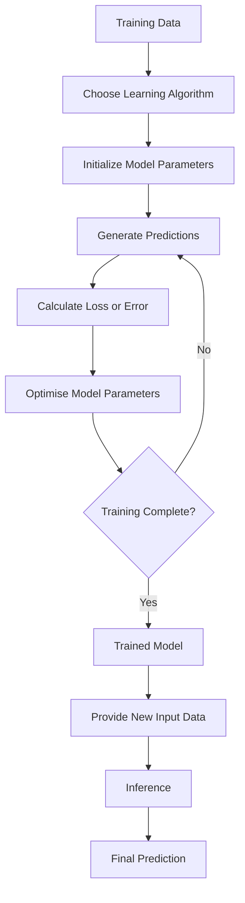

# MISSION 5 | Understand the Anatomy of an ML Model
# Research Question: What happens between feeding data into an ML system and receiving a prediction?
# Answer:
When data is given to a machine learning system, the system uses a trained model to process the input and generate a prediction. Before the model can make predictions, it usually goes through a training process in which a learning algorithm learns patterns from example data.
During training, the model makes predictions and compares them with the correct target answers. A loss function measures the prediction errors, and an optimisation process adjusts the model's parameters to improve its predictions. This process continues until the training reaches a suitable stopping point.
After training, the trained model is used for inference. During inference, new input data is given to the model, and it produces a prediction using the patterns it has learned.
# Distinguish an Algorithm, a Model, and Learned Parameters
An algorithm, a model, and learned parameters are three different parts of a machine learning system.
Algorithm: An algorithm is the method or procedure used to learn patterns from training data.
Model: A model is the result of the learning process. It uses the learned patterns to make predictions on new data.
Learned parameters: Parameters are the values adjusted during training so that the model can make better predictions.
For example, in linear regression, the algorithm learns a relationship between input data and numerical outcomes. The trained model uses that relationship to predict an output for a new input.
| Term | Meaning | Example |
|---|---|---|
| Algorithm | A method used to learn patterns from data. | Linear regression |
| Model | The system that learns patterns and makes predictions. | A model that predicts chip power consumption |
| Parameters | Values the model learns during training. | Weights and bias in linear regression |
| Training | The process of learning patterns from example data. | Learning the relationship between chip frequency and power |
| Inference | Using a trained model to make predictions on new data. | Predicting power consumption for a new chip |
# Explain Training Versus Inference
Training and inference are two important stages in machine learning.
Training is the process in which the algorithm learns patterns from example data. During training, the model makes predictions, compares them with the correct answers when available, measures the errors, and adjusts its parameters to improve its predictions.
Inference is the process of using a trained model to make predictions on new data. The model applies what it has already learned to produce an output.
| Training | Inference |
|---|---|
| The model learns patterns from training data. | The trained model uses learned patterns to make predictions. |
| Parameters are adjusted to reduce prediction errors. | The learned parameters are used to process new inputs. |
| Training data is used. | New or unseen input data is used. |
| It may require many iterations. | It usually produces an output after processing the input. |
| Example: Learning from chip frequency and power data. | Example: Predicting the power consumption of a new chip. |
# Describe How Model Outputs Are Compared with Target Answers During Training
During training, a model receives input examples and produces predictions. When the correct target answers are available, the predictions can be compared with those targets to measure how far the model's outputs are from the expected results.
For example, suppose a model predicts the power consumption of a semiconductor chip. If the actual power consumption is known, we can compare the predicted value with the actual value and calculate the error.
The model uses this error information during training to improve its parameters.
| Step | Process | Explanation |
|---|---|---|
| 1 | Input Data | The model receives training examples. |
| 2 | Initial Parameters | The model starts with initial parameter values. |
| 3 | Prediction | The model produces predictions from the input data. |
| 4 | Error Calculation | The predictions are compared with the correct target values. |
| 5 | Loss Function | A loss function measures how far the predictions are from the target values. |
| 6 | Optimisation | The model's parameters are adjusted to reduce the loss. |
| 7 | Repetition | The process repeats until a suitable stopping point is reached. |
| 8 | Trained Model | The model is ready to make predictions on new data. |
# Explain the Intuition Behind Loss/Error Measures and Optimisation
A loss function measures how far a model's prediction is from the correct target. It gives the training process a way to measure how well the model is performing.
For example, if a model predicts a chip's power consumption as 8 watts when the actual value is 10 watts, the prediction has an error of 2 watts.
An optimisation process adjusts the model's learned parameters to reduce the loss. It tries to find parameter values that make the model's predictions fit the training data better.
This process can be understood without using complicated mathematics:
1.The model makes a prediction.
2.The prediction is compared with the correct answer.
3.A loss or error measure indicates how far the prediction is from the target.
4.The optimisation method adjusts the parameters.
5.The model repeats the process to improve its predictions.
| Concept | Purpose |
|---|---|
| Prediction | The output produced by the model for an input. |
| Target | The correct answer provided in the training data. |
| Error | The difference between a prediction and its target. |
| Loss Function | Measures the model's prediction error using a defined calculation. |
| Optimisation | Updates the model's parameters to reduce the loss. |
| Parameters | Values learned by the model during training. |

Different machine learning methods use different loss measures and optimisation approaches. For example, linear regression may use squared errors, while classification models may use a loss function designed for predicting categories.
The main idea is that the model learns by using feedback about its predictions to improve its parameters.
# Understand Linear Regression Conceptually
Linear regression is a machine learning method used to predict a numerical value by learning a relationship between input features and known numerical outcomes.
It tries to find a straight line that represents the relationship between the inputs and outputs as closely as possible.
For example, in semiconductor manufacturing, we may want to estimate a chip's power consumption based on its operating frequency. We can provide training examples containing frequencies and their measured power consumption. The algorithm learns a relationship from those examples, and the trained model can estimate the power consumption for a new frequency.
Example of Linear Regression:
| Input (Chip Frequency) | Target Output (Power Consumption) |
|---|---|
| 1.0 GHz | 5 W |
| 1.5 GHz | 7 W |
| 2.0 GHz | 9 W |
| 2.5 GHz | 11 W |

Linear regression is useful when a numerical outcome can be reasonably approximated by a linear relationship. Real semiconductor power consumption can depend on other factors, such as voltage, workload, temperature, and chip design, so a single input may not always provide an accurate prediction.
# Labelled Flow Diagram: From Examples to an Inference Result
The following flow diagram shows how data moves through the training and inference stages of a machine learning system.

How the flow works:
1. The model receives training data containing inputs and target answers.
2. A learning algorithm learns patterns by adjusting the model's parameters.
3. The model generates predictions and measures the errors using a loss function.
4. Optimisation adjusts the parameters to reduce the errors, and this process repeats.
5. Once training is complete, the trained model receives new input data and produces a prediction through inference.
The diagram represents a common training process. The exact learning and optimisation methods can differ between machine learning algorithms.

## References
1. Google for Developers. *Machine Learning Crash Course*. https://developers.google.com/machine-learning/crash-course/
2. Scikit-learn. *Getting Started: Fitting and Predicting*. https://scikit-learn.org/stable/getting_started.html
3. Google for Developers. *Machine Learning Resources*. https://developers.google.com/machine-learning
4. GitHub Docs. *Creating Diagrams*. https://docs.github.com/en/get-started/writing-on-github/working-with-advanced-formatting/creating-diagrams
