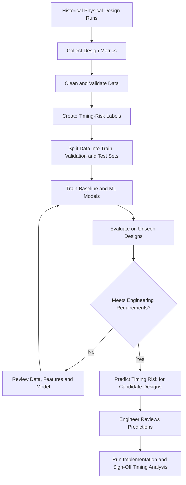

# Final Challenge — Engineering Case Study

## Predicting Timing Risk in Physical Design

**VLSIGURU | AI Literacy Layer | Week 04**

**Application status:** Proposed solution for this assignment. This case study does not claim that this specific system has been deployed in industry.

## 1. Engineering Problem

In Physical Design (PD), engineers aim to meet timing constraints while balancing power, performance and area (PPA).

Some implementation runs fail to meet their timing targets and require additional optimisation. Running every possible configuration through a complete implementation flow can consume considerable engineering time and computing resources.

A proposed Machine Learning (ML) system could predict whether a candidate design configuration is likely to meet its timing target. Engineers could use this prediction to prioritise promising configurations and identify potentially risky designs earlier.

However, the ML model would support decision-making rather than replace static timing analysis (STA) or final sign-off checks.

## 2. Required Input Data

The model could learn from authorised historical Physical Design runs.

| Feature | Description | Purpose |
|---|---|---|
| Cell count | Number of cells in the design | Indicates design size and complexity. |
| Cell area | Estimated or measured standard-cell area | Helps describe the design's physical characteristics. |
| Congestion indicators | Estimates of routing congestion | May help identify potential routing-related timing problems. |
| Estimated wire length | Available wire-length estimates | Provides information about interconnect characteristics. |
| Early-stage timing slack | Timing margin available at the prediction stage | Provides an initial indication of timing risk. |
| Target clock period | Required clock period | Defines the timing requirement. |
| Placement and optimisation settings | Configuration choices used during implementation | Helps capture differences between implementation runs. |
| Final timing result | Final verified timing outcome | Provides the target label for supervised learning. |

Only authorised, non-confidential data should be used. Confidential RTL, netlists, timing constraints and restricted engineering information must not be uploaded to public AI services.

## 3. Data Preparation and Target

Before training the model, the engineering team should:

1. Remove duplicate records and investigate missing values.
2. Ensure that measurements use consistent units.
3. Verify the final timing labels against trusted timing reports.
4. Select features that are available when the prediction will be made.
5. Separate training, validation and test data.
6. Check for data leakage and ensure that closely related runs do not improperly appear across different datasets.

### Target Label

For this case study, the target can be defined as a binary classification problem.

| Target label | Meaning |
|---|---|
| `1` | Timing failure: the design does not meet the specified timing target. |
| `0` | Timing pass: the design meets the specified timing target. |

The engineering team must define the timing criterion precisely, including the relevant slack requirement and applicable analysis conditions.

This label definition makes it easier to interpret the model as a timing-risk predictor.

## 4. Proposed ML Model

The proposed system would use supervised learning because historical design runs provide input features and known timing outcomes.

The following approach can be used:

| Stage | Proposed approach |
|---|---|
| Baseline | Use a documented rule based on available early-stage slack or another established engineering threshold. |
| First ML model | Train a decision tree using structured design metrics. |
| Improved model | Compare a gradient-boosted tree with the baseline and decision tree. |
| Optional model | Evaluate a neural network if sufficient representative training data is available. |
| Model selection | Select the simplest model that meets the required accuracy, reliability and runtime constraints. |

The baseline is important because the ML model should demonstrate a meaningful improvement over a simple, transparent approach.

## 5. Proposed System Flowchart

The flowchart describes a proposed workflow, not a completed implementation.

## 6. Why Might ML Be Useful?

Timing outcomes can depend on several interacting variables, including congestion, cell area, estimated wire length, timing slack and implementation settings.

A model trained on historical runs may learn relationships among these variables and estimate timing risk before a complete implementation run is finished.

Potential benefits include:

- Prioritising candidate configurations for further investigation.
- Identifying potentially risky runs earlier.
- Reducing unnecessary implementation iterations.
- Supporting engineers when comparing design configurations.

Research has investigated ML-based timing prediction and optimisation in VLSI design, demonstrating that this is a relevant engineering application. However, published results from other systems do not establish the performance of this proposed model.

## 7. Evaluation Plan

The model should be evaluated on independent designs or project groups that were not used during training or model selection.

| Metric | Purpose |
|---|---|
| Precision | Of the runs predicted to fail timing, how many actually fail? |
| Recall | Of all runs that actually fail timing, how many did the model identify? |
| Confusion matrix | Shows correct and incorrect predictions for both timing classes. |
| False-negative analysis | Identifies timing failures incorrectly predicted as passes. |
| False-positive analysis | Identifies timing-passing runs incorrectly predicted as failures. |
| Inference time | Measures how quickly the model produces a prediction. |
| Baseline comparison | Determines whether ML provides a meaningful improvement over the rule-based approach. |

For this evaluation, the **positive class is timing failure (`1`)**. Therefore, a false negative is a design that actually fails timing but is predicted to pass.

Recall is particularly important because missed timing failures may cause engineers to prioritise unsuitable candidates. Precision also matters because excessive false alarms may cause useful candidates to be deprioritised.

The acceptable trade-off between these metrics must be decided according to the engineering requirements.

## 8. Possible Errors and Consequences

| Error or limitation | Possible consequence | Mitigation |
|---|---|---|
| Predicts a timing pass, but final analysis fails | A risky design may be prioritised. | Confirm timing using trusted sign-off tools. |
| Predicts a timing failure for a design that would pass | A useful candidate may be deprioritised. | Analyse false positives and tune the decision threshold. |
| New designs differ from training examples | Predictions may become unreliable. | Evaluate across design types and monitor changes in the data. |
| Input features contain leaked information | Evaluation results may appear misleadingly good. | Audit features and use only information available at prediction time. |
| Training labels are incorrect | The model may learn misleading relationships. | Validate labels against trusted timing reports. |
| Training and test sets contain closely related runs | Test performance may be overly optimistic. | Split data by design or project where appropriate. |

## 9. Role of Human Review

Physical Design engineers remain responsible for interpreting predictions and making engineering decisions.

They should:

- Review unusual or uncertain predictions.
- Check whether the training data represents the intended designs and conditions.
- Investigate false negatives and other costly errors.
- Confirm final timing using validated implementation and sign-off tools.
- Monitor performance when design characteristics or implementation flows change.

The model should support engineering judgement, not replace it.

## 10. Conclusion

Machine Learning may help predict timing risk in Physical Design by learning from historical implementation runs and interacting design metrics.

A proposed supervised learning model could help engineers prioritise candidate configurations and identify potential timing failures earlier. However, its usefulness must be established by comparing it with a simple baseline and evaluating it on independent, representative designs.

The model must also be assessed for false negatives, false positives, data leakage and changes in design conditions. Final timing decisions must continue to rely on validated engineering tools and the required sign-off checks.

## References

1. Sengupta, P., Tyagi, A. and Chen, H. — [Early Identification of Timing Critical RTL Components Using ML-Based Path Delay Prediction (2023)](https://scholars.duke.edu/publication/1613016). Research on predicting timing-critical paths earlier in the chip-design process.

2. Cao, P., Li, Z. and Ding, W. — [A GNN-Based Placement Optimization Guidance Framework by Physical and Timing Prediction (2025)](https://doi.org/10.3390/electronics14020329). Research on using physical and timing predictions to guide placement optimisation.

3. Scikit-learn — [Precision, Recall and Classification Evaluation](https://scikit-learn.org/stable/modules/model_evaluation.html). Reference for classification metrics, confusion matrices and model evaluation.
