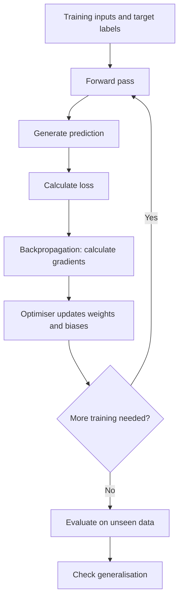

# Mission 4 — How Does a Neural Network Learn?

**VLSIGURU | AI Literacy Layer | Week 04**

## 1. Forward Pass

A **forward pass** is the process of passing input data through a neural network to produce a prediction. The input travels through the input layer and hidden layers before reaching the output layer.

For example, a neural network receives a semiconductor wafer inspection image and predicts whether it contains a defect. During the forward pass, the network uses its current weights, biases and activation functions to calculate the prediction.

## 2. Loss Function

A **loss function** measures how different the model's prediction is from the expected target according to a chosen mathematical rule.

- A high loss generally indicates a poor prediction for the selected loss function.
- A low loss generally indicates a prediction closer to the target.
- Different tasks may require different loss functions.

**Example:** If a wafer image contains a defect but the model predicts that it is defect-free, the loss function measures the error according to the selected classification loss.

Loss is a training signal, not a complete measure of real-world model performance.

## 3. Backpropagation

**Backpropagation** calculates gradients that describe how the loss changes with respect to the network's weights and biases.

These gradients help identify how changes to the parameters could reduce the loss. Backpropagation calculates the gradients; it does not itself perform the parameter updates.

## 4. Optimisation

An **optimisation algorithm**, such as gradient descent or Adam, uses the calculated gradients to update the network's parameters.

The aim is to reduce the loss on the training data over repeated updates. The learning rate controls the size of parameter updates.

For example, if a model repeatedly misclassifies wafer inspection images, optimisation adjusts its parameters so that future predictions may improve.

However, improvement is not guaranteed with every update, and reducing training loss does not necessarily mean the model will perform well on new images.

## 5. Epoch and Iteration

| Term | Meaning |
|---|---|
| Epoch | One complete pass through the training dataset. |
| Batch | A group of training examples processed together. |
| Iteration | One training update step, usually after processing a batch. |
| Learning rate | A setting that controls the size of parameter updates. |

Neural networks usually train for multiple epochs. The number of epochs alone does not determine whether a model has learned well.

## 6. Training vs. Inference

| Training | Inference |
|---|---|
| Learns model parameters from training examples. | Uses learned parameters to make predictions. |
| Calculates loss during training. | Normally does not calculate training loss or update parameters. |
| Uses target labels in supervised learning. | Receives new input data and produces an output. |
| Repeats parameter updates during optimisation. | Applies the trained model to the input. |
| Aims to learn useful patterns from the data. | Aims to provide predictions for practical use. |

## 7. Neural Network Learning Flowchart

The following flowchart shows how a neural network learns from training examples.

**Note:** During training, the forward pass and parameter updates repeat across batches and epochs. After training, validation and test data help assess whether the model has learned patterns that work beyond its training examples.

## 8. What Happens When the Model Makes Mistakes?

Consider a neural network that classifies semiconductor wafer inspection images as **defect** or **no defect**.

### Situation A — Incorrect Training Labels

Suppose an image containing a scratch is labelled as defect-free.

1. The network receives the image and its incorrect label.
2. It generates a prediction and calculates loss against that label.
3. Backpropagation and optimisation adjust the parameters using the misleading training signal.
4. The model may learn an incorrect pattern.

**Solution:** Review the labels, correct annotation errors, retrain when appropriate, and evaluate the model again on independent data.

### Situation B — Good Training Performance but Poor Performance on New Images

Suppose the model performs well on training images but misses defects in images captured under different lighting conditions.

Possible causes include:

- **Overfitting:** The model has learned training-specific details instead of general patterns.
- **Data distribution shift:** Real-world images differ from the training data.
- **Poor data coverage:** Important defect types or inspection conditions are missing.
- **Data leakage:** Information unavailable during real prediction has unintentionally influenced training or evaluation.

**Solution:** Check validation and test results, inspect data quality, remove leakage, and include representative examples of the conditions expected in actual use.

## 9. Understanding Generalisation

**Generalisation** is the ability of a trained model to make useful predictions on data that it did not see during training.

| Dataset | Purpose |
|---|---|
| Training set | Used to learn the model's parameters. |
| Validation set | Used to compare model configurations and guide training decisions. |
| Test set | Used for final evaluation on data kept separate from model development. |

A model that performs well on training data but poorly on unseen data may be overfitting or facing a data-quality or distribution problem.

For semiconductor inspection, the evaluation data should represent the defect types, imaging conditions and production conditions in which the model is expected to operate.

## 10. Why Is Data Quality Important?

A neural network learns from the examples provided to it. Therefore, its results depend not only on its architecture but also on the quality and representativeness of its training data.

| Data problem | Possible effect on the model | Possible solution |
|---|---|---|
| Incorrect labels | The model learns misleading relationships. | Review and correct labels. |
| Missing defect examples | The model may fail to recognise unfamiliar defect types. | Collect representative examples. |
| Noisy images | Important defect features may be difficult to recognise. | Improve image capture and preprocessing. |
| Duplicate or leaked data | Evaluation results may appear better than actual performance. | Check dataset splitting and remove leakage. |
| Changed inspection conditions | Accuracy may decrease after deployment. | Monitor performance and evaluate new conditions. |

## Conclusion

A neural network learns through repeated forward passes, loss calculations, backpropagation and optimisation. These steps adjust the model's weights and biases to improve its predictions on training examples.

However, low training loss does not guarantee reliable predictions in real-world situations. Evaluating the model on unseen data, maintaining high-quality labels and monitoring changes in inspection conditions are essential for building a dependable semiconductor defect detection system.
## References

1. [Google for Developers — Neural Networks](https://developers.google.com/machine-learning/crash-course/neural-networks)
2. [Google for Developers — Training Using Backpropagation](https://developers.google.com/machine-learning/crash-course/neural-networks/backpropagation)
3. [Scikit-learn — Cross-Validation and Model Evaluation](https://scikit-learn.org/stable/modules/cross_validation.html)
