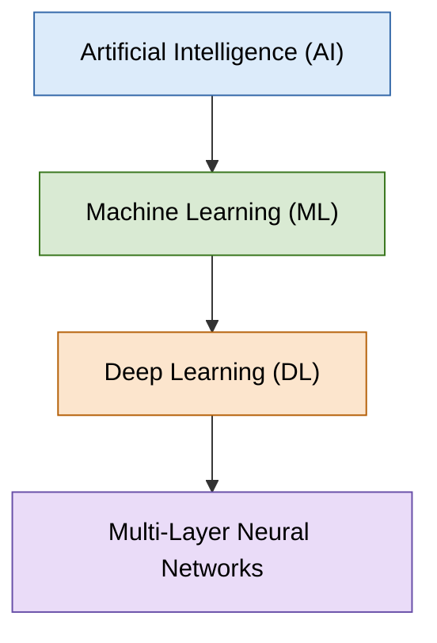
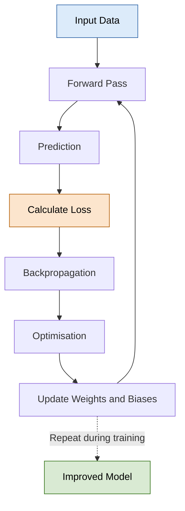

# Mission 2 — What Makes Deep Learning Different?

**Research Question:** Why do we need neural networks when traditional Machine Learning is already available?

## 1. Relationship Between AI, ML, and Deep Learning

Artificial Intelligence, Machine Learning, and Deep Learning are related concepts, but they do not mean the same thing.

- **Artificial Intelligence (AI):** The broad field of creating systems that perform tasks associated with intelligent behaviour.
- **Machine Learning (ML):** A subset of AI in which systems learn patterns from data.
- **Deep Learning (DL):** A subset of ML that uses neural networks with multiple layers to learn complex patterns.
- **Neural Network:** A computational model made of connected units that process inputs using learned parameters such as weights and biases.

### Relationship Diagram

*Note: This diagram shows the conceptual relationship. Deep learning is based on neural networks with multiple layers; neural networks are not a completely separate field outside deep learning.* [1]

## 2. Comparison of Different Approaches

| Approach | How It Works | Semiconductor Example | Limitation |
|---|---|---|---|
| Rule-based system | Follows rules explicitly written by an engineer | Flag a design when a timing measurement exceeds a specified limit | Does not automatically learn new patterns |
| Traditional ML | Learns relationships from data using selected features | Predict timing risk using cell count, congestion, and early-stage slack | Performance depends on feature quality and representative data |
| Deep learning | Learns useful representations through multiple neural-network layers | Classify wafer inspection images as scratch, stain, or no defect | May require more training data and computing resources |

Traditional ML can work very well with structured numerical data, while deep learning is particularly useful when inputs contain complex patterns, such as images. Neither approach is automatically better for every problem. [1][2]

## 3. What Is a Neural Network?

A neural network is a computational model containing connected processing units called **neurons** or **nodes**. These neurons are organised into layers.

- **Input layer:** Receives the input data.
- **Hidden layers:** Transform the information and learn patterns.
- **Output layer:** Produces the final prediction.
- **Weights:** Control the influence of connections between neurons.
- **Biases:** Help adjust neuron outputs.
- **Activation functions:** Allow the network to learn complex, nonlinear relationships.

During training, the network adjusts its weights and biases to improve its predictions.

For example, a neural network trained on wafer inspection images may learn patterns associated with scratches, stains, or other visible defects. The patterns are learned from training data rather than being fully specified as manual rules. [2]

## 4. How Does a Neural Network Learn Patterns?

A neural network learns through repeated training steps.

The process works as follows:

1. **Input:** The model receives training data.
2. **Forward pass:** The network processes the input and generates a prediction.
3. **Loss calculation:** A loss function measures the difference between the prediction and the target.
4. **Backpropagation:** The network calculates how its parameters contributed to the error.
5. **Optimisation:** An optimisation algorithm adjusts the parameters to reduce the loss.
6. **Repetition:** The process repeats over training examples.

The goal is to learn patterns that generalise to new data rather than simply memorising training examples. [2][3]

## 5. Why Can Deep Learning Be Useful?

Many real-world inputs contain complex patterns that are difficult to describe using fixed rules or manually selected features.

| Application | Input Data | Expected Output |
|---|---|---|
| Semiconductor inspection | Wafer or chip inspection images | Defect category |
| Plant disease identification | Photographs of leaves | Disease category |
| Speech recognition | Audio signals | Recognised words |
| Physical Design analysis | Design features and implementation data | Predicted congestion or timing risk, when supported by suitable data |

For semiconductor inspection, a deep-learning model may learn image patterns associated with scratches, stains, or other defects. For Physical Design, a model may use design-related features to predict congestion or timing risk.

These are potential applications, not guarantees of improved results. Performance depends on the training data, model design, evaluation process, and engineering requirements. [1][2]

## 6. Does Adding More Layers Always Improve Accuracy?

No. Additional layers can help a network learn more complex representations, but they also increase model complexity and may require more computing resources.

| Model Behaviour | Meaning | Possible Reason |
|---|---|---|
| Underfitting | Model performs poorly on training data and unseen data | Model may be too simple or insufficiently trained |
| Good generalisation | Model performs well on training and unseen data | It has learned useful patterns |
| Overfitting | Model performs well on training data but poorly on unseen data | It may have memorised training-specific patterns |

A larger network may overfit when the training data is insufficient or unrepresentative. Therefore, model complexity should be selected using validation results, and the final model should be evaluated on a separate test set. [3]

## 7. When Is a Simpler Approach Better?

| Approach | Suitable When | Example |
|---|---|---|
| Rule-based system | The decision follows a clear, stable engineering rule | Flag a timing value that exceeds a fixed limit |
| Traditional ML | Structured numerical features are available and a learned prediction is needed | Predict timing risk from cell count and congestion metrics |
| Deep learning | Complex inputs contain patterns that are difficult to describe manually | Classify defects in wafer inspection images |

Engineers should start with the problem rather than automatically choosing the most complex technology. A simple rule or traditional ML model may be cheaper, easier to interpret, and sufficient for the task.

## Conclusion

Deep learning is a powerful part of Machine Learning because multi-layer neural networks can learn complex patterns from data. It is especially useful for applications such as image classification and other tasks where manually defining all relevant features is difficult.

However, deep learning is not always the best solution. Rule-based systems and traditional ML may be more suitable when the problem is simple or structured data is available. The engineering problem, data quality, performance requirements, computational cost, and consequences of incorrect predictions should guide the choice of approach.

## Sources 

1. IBM — **AI vs. Machine Learning vs. Deep Learning vs. Neural Networks**  
   https://www.ibm.com/think/topics/ai-vs-machine-learning-vs-deep-learning-vs-neural-networks

2. Google for Developers — **Machine Learning Crash Course**  
   https://developers.google.com/machine-learning/crash-course/

3. TensorFlow — **Overfit and Underfit**  
   https://www.tensorflow.org/tutorials/keras/overfit_and_underfit
